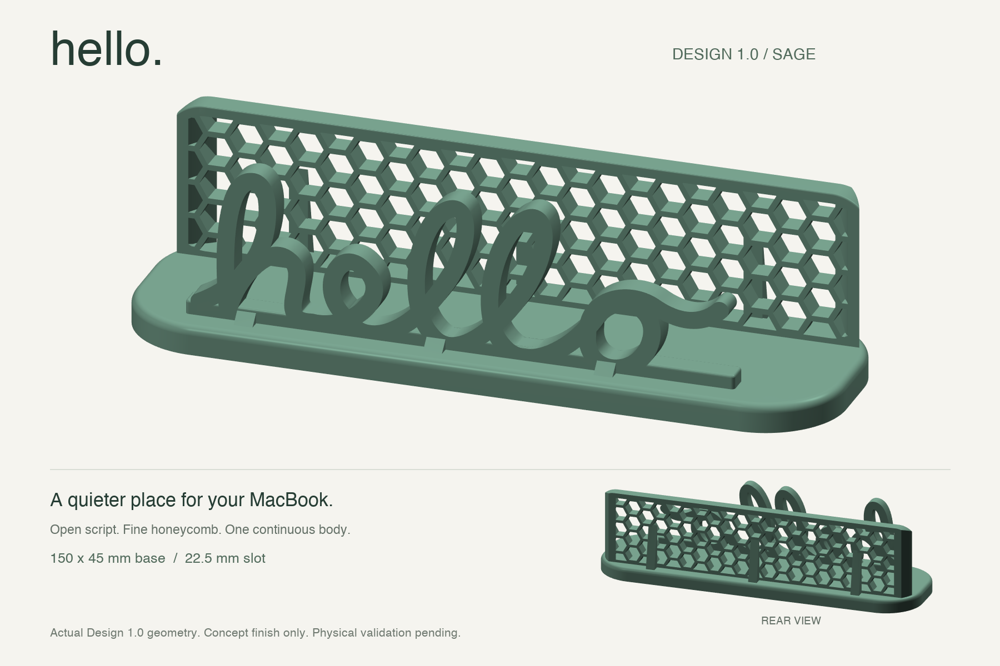
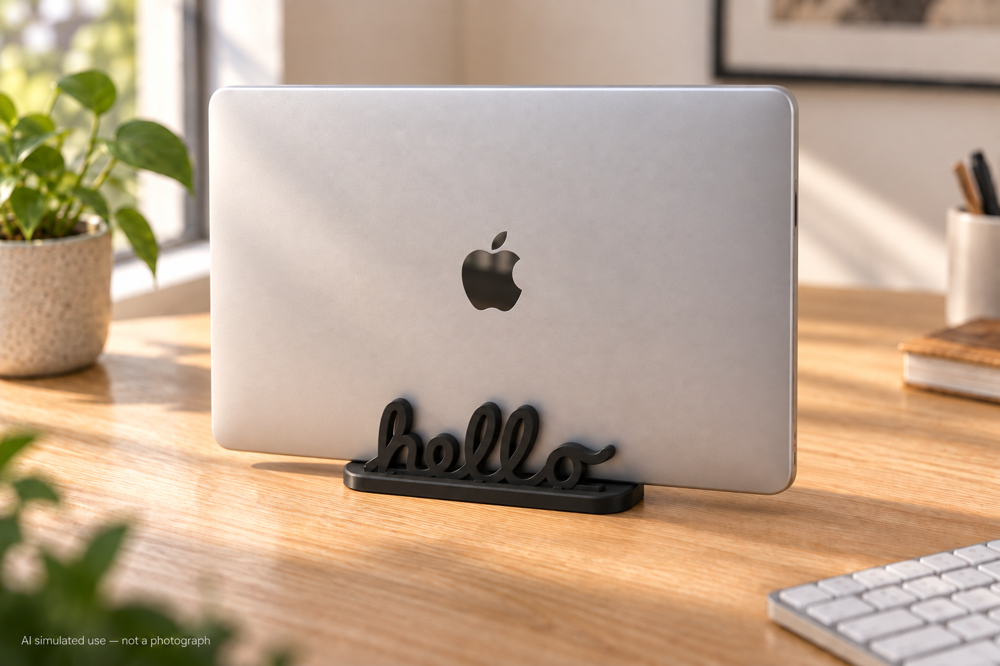
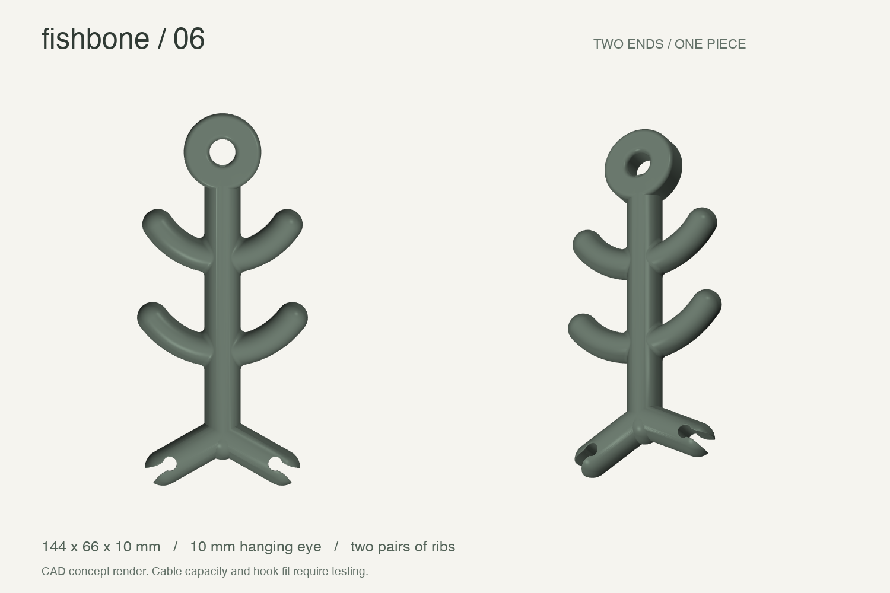
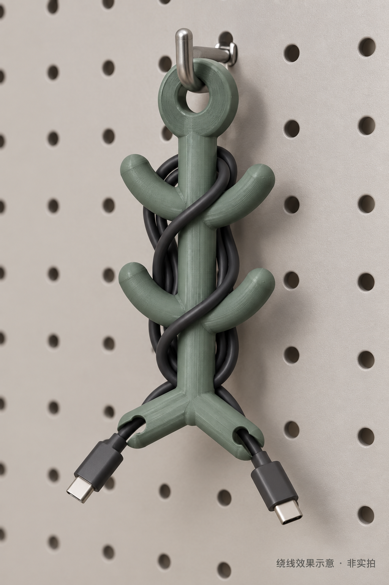
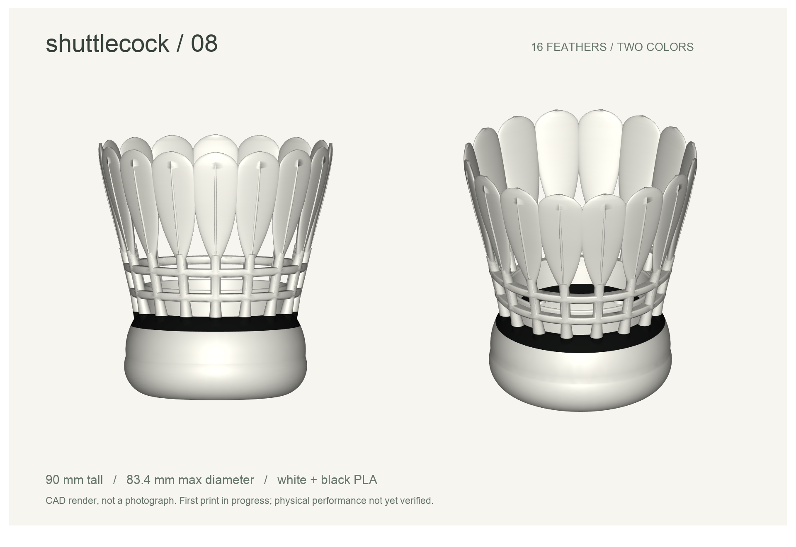
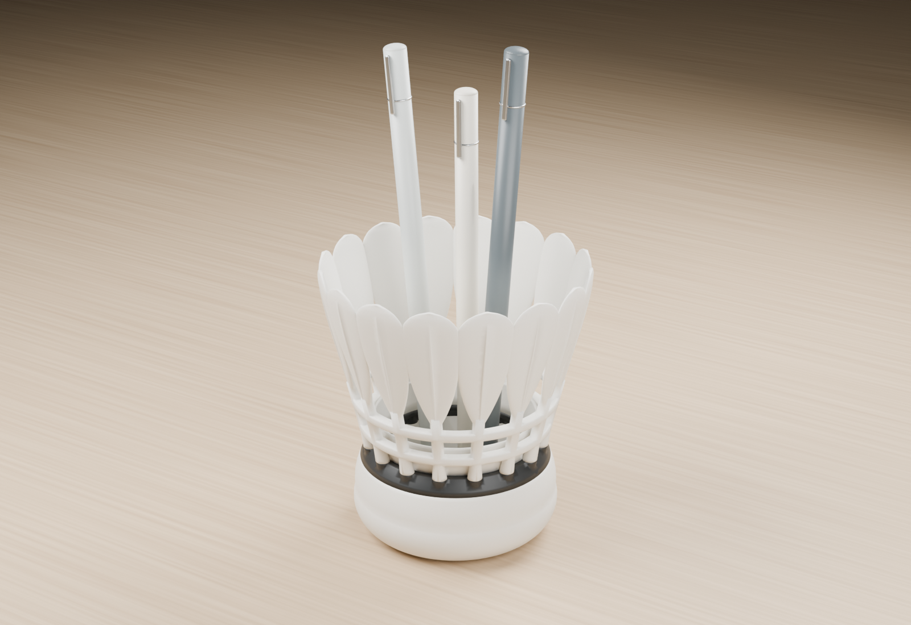
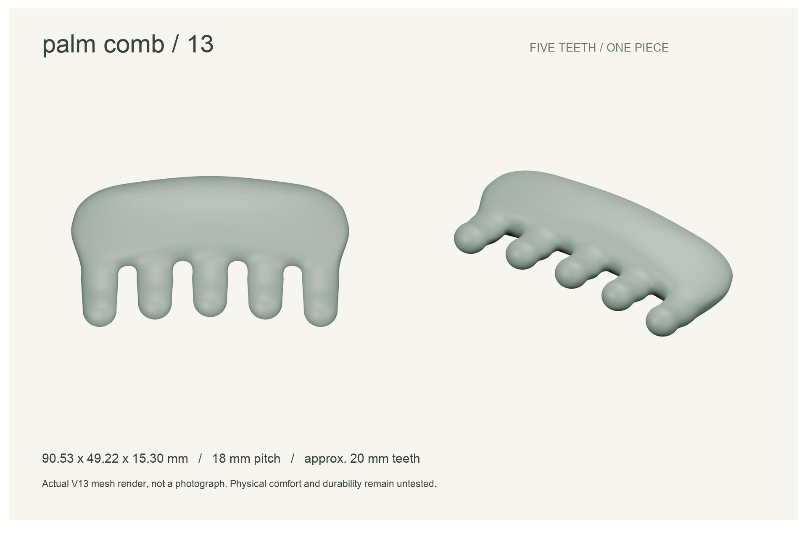
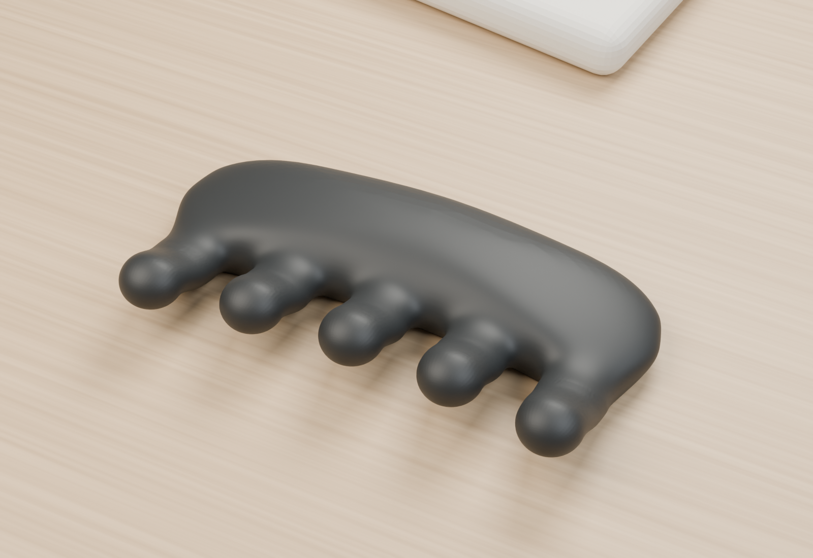

# 3D 打印项目集 / 3D Printing Projects

从设计、建模到打印和实物反馈，持续收集我们的 3D 打印作品。后续新项目统一加入这个仓库，每个作品保留独立目录和说明。

A growing collection of our 3D printing projects: CAD models, design illustrations, print settings and real-world feedback.

## 项目一览 / Projects

| 项目 / Project                                                 | 当前版本         | 实物进展                                       |
| -------------------------------------------------------------- | ---------------- | ---------------------------------------------- |
| [hello · MacBook 竖放支架](macbook-vertical-stand/)            | Design 1.0 / V14 | 打印完成，用户初步使用反馈良好                 |
| [Fishbone · 鱼骨收线器](fishbone-cable-organizer/)             | V06              | 打印完成；使用方便，保留现有尺寸               |
| [羽毛球笔筒 / Shuttlecock pen holder](shuttlecock-pen-holder/) | V08              | 双色切片完成，已提交首件试打，待实物验收       |
| [小巧鞋拔 / Compact shoehorn](shoehorn/)                       | V04              | 外观已认可；模型检查通过，尚未试印             |
| [掌心按摩梳 / Palm massage comb](scalp-massage-comb/)          | V13 试验         | 外观已认可；慢速切片完成，暂缓打印，未提交任务 |

## 图像说明 / Image guide

每个项目统一展示两类图片：**设计图**说明形状、结构与尺寸；**实际效果图**展示使用场景或拟真实外观。目前的场景图为 CAD 渲染或 AI 模拟，均在图片下标注，不能当作打印实拍或实物验收依据。真实照片只在取得实拍后以“实拍”标注。

Each project shows a design view and an in-context view. CAD renders, AI illustrations and physical photographs are identified explicitly; a simulated scene does not establish physical validation.

### hello · 竖放支架

**Design 1.0 / V14** · 开放 hello 前挡架、蜂窝后框与 150 × 45 mm 一体底座。用户已确认打印完成，初步使用反馈良好；长期稳定性仍待验证。

A compact closed-laptop stand with open lettering and a honeycomb rear frame. The first print and positive initial use are user-reported.

#### 设计图 / Design

_鼠尾草绿 CAD 展示渲染，来自实际模型。_

#### 实际效果图 / In context

_AI 模拟桌面使用场景，非打印实拍；电脑适配以实测为准。_

[项目介绍 / Project](macbook-vertical-stand/) · [STEP](macbook-vertical-stand/v14/stand-v14.step) · [STL](macbook-vertical-stand/v14/stand-v14.stl) · [打印记录](macbook-vertical-stand/docs/first-print-2026-09-16.md)

### Fishbone · 鱼骨收线器

**V06** · 两对浅弧骨节、双端卡槽与悬挂孔。首件已打印，用户反馈使用方便，保留现有尺寸；线缆容量和挂钩适配仍待验证。

A one-piece cable organizer with two curved rib pairs, two cable slots and a hanging eye. Keep the current V06 size.

#### 设计图 / Design

_V06 正视与透视 CAD 设计渲染。_

#### 实际效果图 / In context

_AI 模拟绕线与悬挂场景，非实拍或经验证的线缆路径。_

[项目介绍 / Project](fishbone-cable-organizer/) · [STEP](fishbone-cable-organizer/models/v06/fishbone-v06.step) · [STL](fishbone-cable-organizer/models/v06/fishbone-v06.stl) · [打印记录](fishbone-cable-organizer/docs/PRINTING.md)

### 羽毛球笔筒 / Shuttlecock pen holder

**V08** · 16 片宽圆羽毛、镂空连接环与圆润球托，白色主体配黑色环带。高 90 mm，最大外径约 83.4 mm；打印与实物进展见项目记录。

A 16-feather pen holder, 90 mm tall and approximately 83.4 mm wide, with a white body and black band.

#### 设计图 / Design

_V08 白黑分区的两视图 CAD 设计渲染。_

#### 实际效果图 / In context

_当前 V08 实际模型的桌面装笔渲染，非打印实拍；道具不代表容量或稳定性验证。_

[项目介绍 / Project](shuttlecock-pen-holder/) · [双色 STEP](shuttlecock-pen-holder/v08/shuttlecock-v08-two-color.step) · [单色 STL](shuttlecock-pen-holder/v08/shuttlecock-v08-single.stl) · [打印记录](shuttlecock-pen-holder/v08/PRINT-PREPARATION.md)

### 小巧鞋拔 / Compact shoehorn

**V04** · 约 18 cm 的直身鞋拔，搭配脚跟凹弧、轻收腰手柄和水滴挂孔。外观已认可；脚跟贴合和耐弯折仍待实物验证。

A compact one-piece shoehorn with a concave heel guide, a waisted grip and a teardrop hanging hole.

#### 设计图 / Design

_V04 整体形状与宽头弧面的 CAD 设计渲染。_

#### 实际效果图 / In context

_AI 模拟坐姿穿鞋场景，非打印实拍或鞋型适配验证。_

[项目介绍 / Project](shoehorn/) · [STEP](shoehorn/v04/shoehorn-v04.step) · [STL](shoehorn/v04/shoehorn-v04.stl) · [三维预览说明](shoehorn/#本地三维预览--local-3d-preview)

### 掌心按摩梳 / Palm massage comb

**V13** · 五个稀疏圆润短齿、浅凹齿列与柔和掌握部，约 90.53 × 49.22 × 15.30 mm。慢速切片完成，用户决定暂缓打印，未提交任务。

A five-tooth palm comb with rounded contacts and a blended grip. Slicing is complete; printing remains paused with no task submitted.

#### 设计图 / Design

_V13 正面与斜视设计渲染，来自当前实际 STL。_

#### 实际效果图 / In context

_当前 V13 的黑色 PLA 桌面效果渲染，非实拍；触感与表面效果仍待验证。_

[项目介绍 / Project](scalp-massage-comb/) · [V13 STL](scalp-massage-comb/v13/massage-comb-v13.stl) · [设计演进](scalp-massage-comb/docs/DESIGN-HISTORY.md) · [打印准备](scalp-massage-comb/docs/PRINT-PREPARATION-V13.md)

## 整理方式 / Organization

每个作品独立保存：中英文介绍、CAD 源码、STEP/STL、设计图、实际效果图及已取得的实拍、打印参数、版本演进及试用反馈。后续项目放入新的作品目录，并在本页添加图片和入口。具体生成和检查命令见各项目 README。

Each project keeps its own documentation and build instructions. Renders, AI illustrations, slicer estimates and physical observations are labeled separately. A successful print is not a comprehensive strength or durability certification.

## 迁移说明 / Migration

两项旧独立仓库已迁入此处；此仓库是后续更新入口。两个旧独立仓库已按用户确认删除，原仓库链接不再使用。此次复制各仓库 main 的已跟踪文件，没有将原来的提交历史合并进本仓库。来源提交与文件完整性核对见 [迁移记录](MIGRATION.md)。本机 3MF、G-code、设备凭据不纳入迁移。

This repository is the ongoing home for future projects. The two original repositories have been deleted after migration; this collection is the single ongoing repository.

## 开源许可 / License

本仓库原创代码、CAD 模型和展示素材采用 [MIT License](LICENSE)，允许使用、修改和再分发（包括商业用途），请保留版权和许可声明。第三方软件、商标及其权利不包含在本授权中。

Original code, CAD models and presentation assets are available under the MIT License. Third-party dependencies and trademarks retain their respective terms and rights. Designs are provided without warranty; verify fit and suitability before use.
