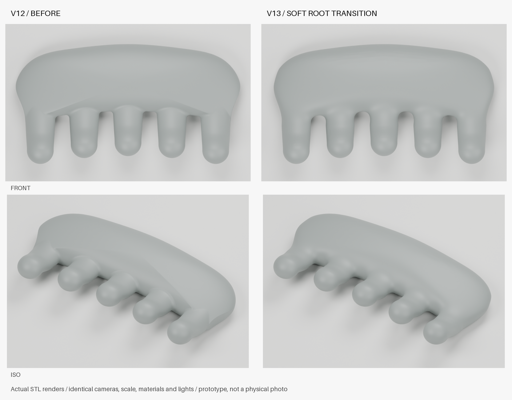

# 掌心按摩梳 / Palm Massage Comb

一把简约、可掌握的五齿按摩梳：稀疏短齿、圆润接触端，齿列浅凹、齿身上弯，握持部与齿根柔和衔接。

A compact, one-piece, five-tooth scalp massage comb with rounded tips, a gently curved tooth arrangement and a softly blended palm grip.

**当前版本：V13 外观已认可；几何检查与慢速切片已完成。用户决定暂缓打印，尚未提交任务，也没有本项目的打印实拍或实物测试结果。**

**Status:** V13 appearance accepted. Mesh checks and a slow PLA slicing pass are complete. Printing is paused at the user's request; no print has been submitted and no physical prototype has been evaluated.

## 拟真实效果图 / Simulated appearance


*实际 V13 STL 的拟真实渲染，非实拍。黑色 PLA、细微层纹与桌面光照仅用于展示；不代表打印表面、柔软度或舒适性。模型未为图片改变形状。*

*Photorealistic render of the actual V13 STL, not a photograph. Black PLA appearance and layer texture are illustrative. The product geometry is unchanged.*

[下载 V13 STL](v13/massage-comb-v13.stl) · [三维预览文件](v13/viewer.html) · [几何检查](v13/validation.json) · [打印准备记录](docs/PRINT-PREPARATION-V13.md) · [设计演进](docs/DESIGN-HISTORY.md)

GitHub 展示文件源码，交互三维预览需下载仓库后通过本地 HTTP 服务打开，运行方式见下文。

## 尺寸与结构 / Dimensions and structure

| 项目 / Item | V13 |
| --- | --- |
| 整体尺寸 / Overall size | 90.53 × 49.22 × 15.30 mm |
| 梳齿数量 / Teeth | 5 |
| 齿中心间距 / Tooth pitch | 18 mm |
| 标称外露齿长 / Nominal exposed length | 约 / approximately 20 mm |
| Y=18 mm 截面最小齿间隙 / Minimum gap at Y=18 mm | 约 / approximately 6.44 mm |
| 模型结构 / Mesh | 封闭、法向一致、正体积、单一连通体 / Watertight, consistently wound, positive volume, connected |
| 当前文件 / Current format | STL；无对应 V13 STEP / STL; no matching V13 STEP |

V13 修改了实际网格表面，缓和握持部前缘与五个齿根之间的 V 形硬折线。局部最大调整约 1.02 mm，体积相对 V12 减少约 0.885%。五齿、间距、约 20 mm 标称齿长与上弯形状保留。齿部接触区及后握持区的双向确定性抽样偏差最大约 0.019 mm；这不是全表面误差上界。

V13 fairs the actual front palm/root mesh rather than only changing shading normals. The comparison uses identical cameras, scale, materials and lights. Sampled distances describe mesh approximation, not exact CAD equality or a proof of curvature continuity.



[曲面精修记录](v13/surface-fairing.json) · [详细构建和限制](v13/README.md) · [V12 历史基准说明](v12/BASELINE.md)

**V12 STEP 仅供历史参考，不能当作 V13 STEP 使用。**

## 慢速试打准备 / Slow PLA trial preparation

已在 Bambu Studio 图形界面核对并重新切片：H2C 0.4 mm 喷嘴、黑色 PLA、增稳低温打印板（SuperTack）、0.12 mm 层高、4 壁、25% Gyroid、树状支撑、5 mm 外侧 Brim。外墙 35 mm/s、首层 20 mm/s。软件估算 **2 小时 27 分钟 / 21.46 g**；此估算只对应该次配置，不含排队、后处理或实际打印误差。

首次载入时软件恢复过部分默认参数；已在界面内重设慢速和支撑、保存并重新切片。发送阶段设备正在执行其他任务，所以没有提交。本次用户进一步决定先暂停打印。另一台设备的实时可用状态未核实；更换设备时必须使用对应机型、喷嘴、板型及实际 PLA 重新切片。

The GUI slicing estimate is **2 h 27 min / 21.46 g** for the documented H2C setup. No task was submitted. Re-slice and verify material, nozzle and plate mappings for any other printer. Local 3MF/G-code jobs, device information and credentials are excluded from this repository.

完整设置、检查范围及重新开打步骤见 [V13 打印准备](docs/PRINT-PREPARATION-V13.md)。

## 验证边界 / What remains untested

- 已完成：封闭性、连通性、法向、尺寸、五齿截面与间隙检查；实际网格对比渲染；慢速切片预览。
- 待实物验证：贴床与支撑拆除、毛刺和层纹、握持、轻触头皮的感受、缠发、受力及耐久。
- PLA 为硬质外形试样材料，不因圆头设计而自动具备柔软或安全接触的表现；触感需要实物确认。
- 渲染、几何检查与切片不证明人体适配、医疗效果、解析曲率连续性或耐久性。先检查和处理毛刺、齿根裂纹与支撑接触痕，再做轻触试用。

Physical fit, comfort, snag resistance, print finish and durability remain untested. This is a design prototype with no medical efficacy claim.

## 本地预览与复现 / Local preview and reproduction

在仓库根目录运行 / From the repository root:

```sh
uv run --python 3.12 python -m http.server 8858 --bind 127.0.0.1 --directory scalp-massage-comb
```

打开 / Open `http://127.0.0.1:8858/v13/viewer.html`。

V13 源码、验证和比较渲染命令见 [构建说明](v13/README.md)。本次发布包含 V13 及复现所需的 V12 基准，早期工作草稿保留在本地。拟真实效果图由本地 Blender 5.2.2 后台渲染，未使用 Blender MCP；图片来源与模型哈希见 [渲染记录](assets/showcase-v13.json)。

```sh
/Applications/Blender.app/Contents/MacOS/Blender -b -t 4 --python scalp-massage-comb/assets/render_showcase.py
```
