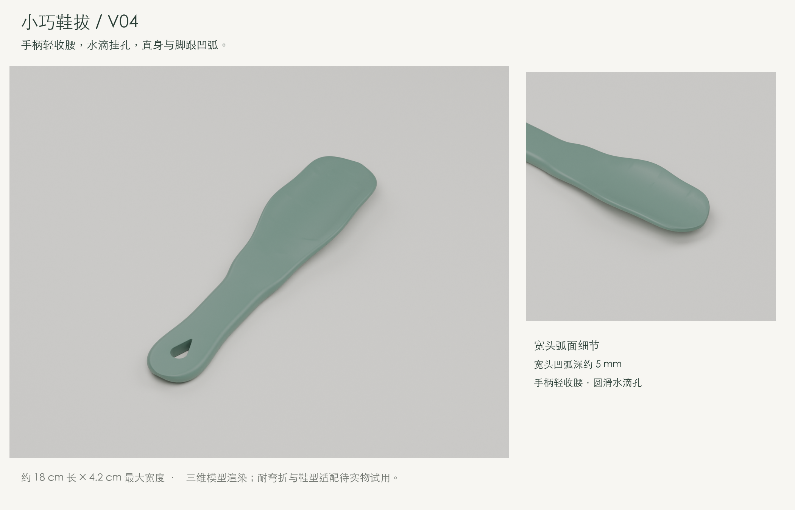
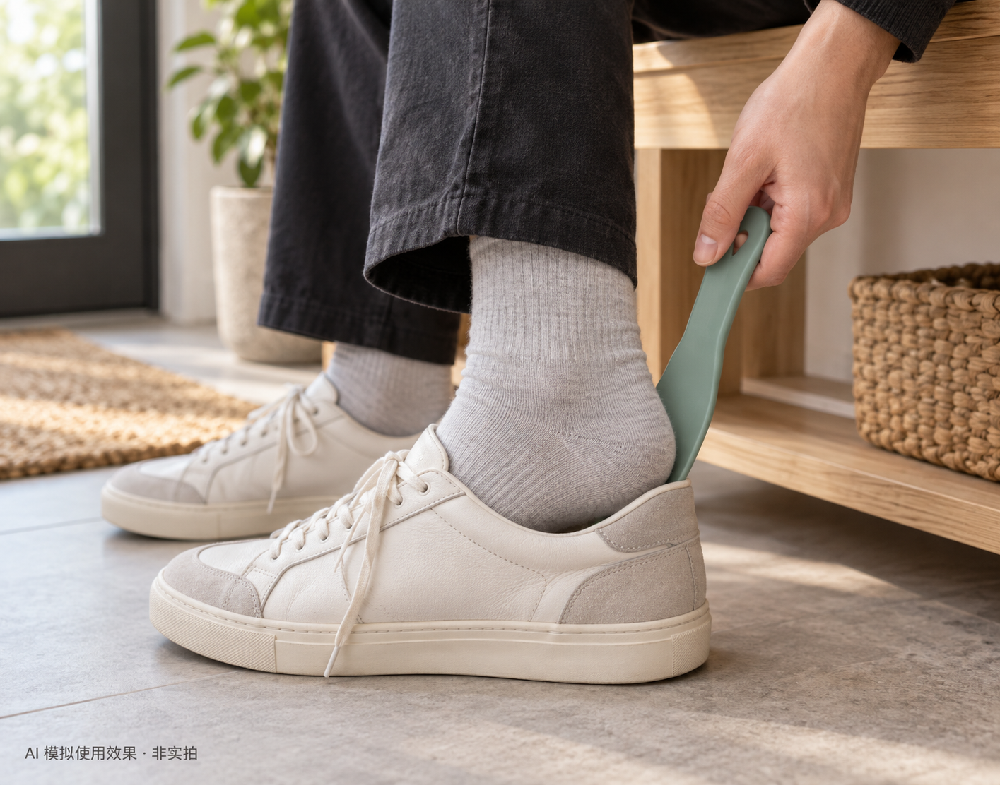

# 小巧鞋拔 · V04 / Compact shoehorn

一体式辅助穿鞋工具，按坐着穿鞋、方便收纳的场景设计。V04 外观已获用户认可，尚未切片或打印。



[下载 STEP](v04/shoehorn-v04.step) · [下载 STL](v04/shoehorn-v04.stl) · [CAD 检查记录](v04/validation.json) · [网格检查记录](v04/mesh-checks.json)

## 模拟使用效果 / Simulated use



以 V04 模型渲染为参考生成的穿鞋场景：坐着穿鞋，将宽头放在脚跟与鞋后帮之间，手握上方手柄辅助脚跟滑入。此图为 **AI 模拟使用效果，非实拍**；实际形状和尺寸以 CAD 为准，不代表已完成鞋型适配、打印或耐用性验证。

AI-generated scene using the V04 CAD render as a visual reference. The shoehorn guides the heel past the rear shoe counter during seated use. This is **a simulated scene, not a photograph or fit test**. Refer to the CAD files for dimensions and geometry.

[图片生成说明与提示词](assets/simulated-use-v04-generation.json)

## 形状与尺寸 / Shape and dimensions

| 项目 / Item | V04 |
| --- | --- |
| 整体尺寸 / Overall bounds | 约 / approximately 178 × 41.9 × 12.7 mm（长 × 宽 × 厚度方向包络，按 STEP 回读计） |
| 主体 / Body | 一体，沿长度方向的中心线保持直 / one piece, straight longitudinal centre line |
| 宽头 / Heel guide | 横向凹弧，38 mm 截面名义深度约 5.05 mm / transverse concavity |
| 手柄 / Handle | 轻收腰，名义厚度 7.5 mm / softly waisted, nominal thickness 7.5 mm |
| 挂孔 / Hanging hole | 圆滑水滴形，名义长度 15.45 mm，孔口圆角 0.35 mm / rounded teardrop |

V04 调整了手柄两侧轮廓与挂孔形状，继续保持约 18 cm 的小巧尺寸。展示颜色仅用于观察形状，不指定打印颜色。宽头的凹弧尚未经过具体脚跟尺寸的适配验证。

## 当前进展 / Current status

- **已完成**：外观迭代、单实体 CAD 有效性检查、STEP 回读、STL 闭合与正体积检查、网格重新加载检查、交互预览。
- **待完成**：材料与打印朝向选择、切片、首次试印、脚跟与鞋型适配、握持手感、反复弯折验证。
- CAD 展示图来自实际模型；穿鞋场景为 AI 模拟。均非打印实拍，也没有已验证的打印参数。

## 本地三维预览 / Local 3D preview

在仓库根目录运行：

```sh
uv run --python 3.12 python -m http.server 8784 --bind 127.0.0.1 --directory shoehorn/v04
```

随后打开 `http://127.0.0.1:8784/viewer.html`。可拖动旋转、滚轮缩放，或用正面、侧面、端面按钮和滑块。方向键旋转，加减键缩放，Home 复位。预览使用实际 STL 导出的网格，无外部网页依赖。GitHub 文件页面不会直接运行这个交互预览。

## 文件与重建 / Files and rebuilding

- [建模源码](v04/build.py)：尺寸单位为毫米，导出 STEP/STL 并检查实体与 STEP 回读。
- [网格检查](v04/check_mesh.py)：检查闭合性、正体积及导出后的重新加载。
- [预览网格生成](v04/build_preview.py)：由 STL 生成网页使用的 `mesh.bin`。
- [渲染脚本](v04/render.py)与[设计图脚本](v04/board.py)：生成模型展示图。
- [文件校验值](checksums.sha256)：记录这次归档的模型、源码、图片和预览资源，供完整性复核。

[归档复核记录](archive-verification.json)另记录了 STEP 回读尺寸与 STL 一致性。原建模报告使用的保守包围盒略大于导出文件回读包围盒；尺寸差异来自包围盒计算方式，归档未修改模型。

具体重建、检查和格式化命令见 [AGENTS.md](AGENTS.md)。本目录归档当前认可的 V04，早期迭代仍保存在本地设计目录。

## English

A compact one-piece shoehorn intended for seated use. V04 keeps a straight longitudinal centre line and a transversely concave heel guide, with a softly waisted handle and a rounded teardrop hanging hole. Overall bounds are approximately 178 × 41.9 × 12.7 mm.

The user has accepted the appearance. CAD validity, STEP round-trip, watertight positive-volume STL and mesh reload checks have passed. These checks do not establish heel fit, comfort or resistance to repeated bending. Slicing and physical printing have not yet been performed. CAD images are renders of the actual model; the use scene is AI-generated. Neither is a photograph of a printed prototype. Material and colour remain open choices.

Run the local server command above to inspect and rotate the model. Original CAD source, STEP/STL, renders, validation reports and preview assets are included under the repository's [MIT License](../LICENSE).
